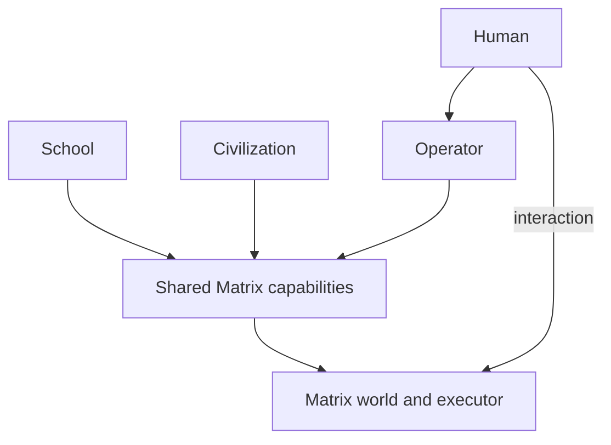

# Matrix architecture

Matrix is the shared world, creation and presentation runtime. School and Civilization use it for independent experiences, with one authoritative state per world instance as the ownership target.

This shows responsibilities, not a new service or a claim that every integration is implemented. Operator and connected experiences use the shared capability boundary; direct interaction also executes in the same Matrix world. Creation uses the procedural, asset and Blender paths described below.

Matrix owns generic WebXR and room AR registration/presentation. Civilization owns geographic data, mapping and overlay meaning. An AR view does not create a second citizen scene or simulation clock.

An optional image-mockup step can precede creation: revise/select a concept, turn it into a scene/object plan, then build it through procedural generation or Blender.

## World and simulation

The target is one authoritative Matrix world state for a world instance. Visitors observe and act on that state; they do not each own a competing copy of the citizen simulation.

Persistent Civilization residents should continue through a world owner even when no browser is open, then reappear with the same identities/state when a human rejoins. Current implementation work is converging on that model; do not claim it is complete until the relevant persistence/replay acceptance passes.

Today, the ordinary `/web/` world is browser-owned. The separately started PC-owned Ada/Bo fixture has a read-only `/web/hosted.html` viewer; it does not migrate arbitrary user-created worlds to a persistent host. See [the host runbook](Docs/Persistent-World-Host.md).

## `WebRuntime/`

Owns the Three.js/WebXR client and world presentation:

- rendering;
- desktop/VR/AR views;
- interaction;
- physics presentation and runtime behaviors;
- world/entity views;
- browser-side controls and compatible persistence.

## `ControlService/`

Owns the PC-local privileged boundary:

- persistent Agent Portal;
- capability/tool discovery;
- reviewed commands;
- procedural/asset/Blender workflows;
- runtime receipts and validation;
- PC-side checkpoints and persistent-world coordination as implemented.

Privileged Codex, GitHub, Blender or MCP credentials stay on the PC side.

## Operator and creation

Operator is the user-facing creation capability, not a separate world.

A request can resolve through:

1. **Procedural generation** for fast parameterized structures, layouts, experiments and objects.
2. **Blender MCP + validated import** for richer custom geometry/animation.
3. **Reusable assets/capabilities** when suitable content already exists.
4. **Optional image mockup** for art direction before procedural/Blender creation.

All paths converge on ordinary Matrix entities/capabilities with identity, permissions, receipts and persistence.

Consumers keep their domain identities and intent, request scoped actions, and receive Matrix observations/receipts. Matrix validates and executes; a mentor or resident identity alone grants no authority. New integration adapters and grants remain proposed until implemented.

## Civilization / AI Citizens

Civilization owns resident intentions and society behavior, including the Boulder/geographic-overlay experience. Matrix executes its bounded world actions and presents the resulting state.

Citizens can grow toward memory, reflection, needs, schedules, planning, navigation, social behavior and persistent relationships. They may request creation through the same bounded Matrix capabilities humans use, but they do **not** receive Operator/PC credentials.

Do not create a resident-only scene graph, executor, physics system or hidden second world.

## School

School owns historical-figure conversations, mentor identities, teaching and learner records. A figure requests supported presentation material through Operator and scoped Matrix capabilities. Its visible guide can be an ordinary Matrix avatar/entity without starting `CitizensSimulation`; School mentor identity and Matrix entity identity remain distinct. School and Civilization do not depend on each other's simulation or delivery schedule.

## Geographic observations: research direction

[Emergence World research](https://github.com/School-of-the-Ancients/matrix-loading-operator/blob/60ab4599752147f2e590293208bee4692965a524/Docs/Research/Emergence-World.md) informs a possible Civilization public-data input to the existing world owner. Civilization owns the data's geographic and simulation meaning; Matrix receives bounded world actions. Preserve the source, geography, observation/fetch timestamps, units and freshness; distinguish the observation from a rule-derived simulated condition and a Citizen inference. Replay would need the recorded input snapshot. External information must not grant capabilities or create another simulation owner/clock. This is a proposed contract, not an implemented data adapter or NYC reconstruction; private Manfred context remains separate.

## Persistence

Save enough versioned state to reconstruct the supported experience without silently resetting unrelated work. Preserve stable entity/citizen IDs and authored parameters where practical.

## Module and repository boundaries

- **Matrix:** shared world runtime, Operator, creation/presentation pipelines, generic WebXR/room AR and world persistence.
- **School:** independent historical-figure conversations, mentor identities, teaching, curriculum, assessment and learner records.
- **Civilization:** independent resident/society simulation, Boulder and geographic AR overlay data/meaning.
- **Manfred:** private human/wearable context.
- **school-of-the-ancients-roadmap:** cross-project coordination/research only.
- **Unity archive:** historical implementation only.

These are responsibility boundaries, not mandatory deployments or repository splits. Current Citizens code remains under `WebRuntime/src/citizens*.js` in this repository and uses the existing Matrix runtime.

## UX and guided lessons

The [archived modular UX proposal](https://github.com/School-of-the-Ancients/matrix-loading-operator/blob/60ab4599752147f2e590293208bee4692965a524/Docs/Matrix-Modular-UX-Plan.md) applies these boundaries to
one Operator experience across desktop/VR/AR. Modules are responsibilities,
not mandatory new repositories or tabs. School requests supported presentation material;
Operator orchestrates and Matrix executes. Create/Play and capability authority
remain separate. The plan distinguishes current reviewed proposals from proposed
lesson-session delegation and preserves existing world/state ownership.

## Design rule

Before adding a service/framework/repository, ask whether the existing `WebRuntime/` and `ControlService/` with these module boundaries can do the job. Prefer extending the current system.
