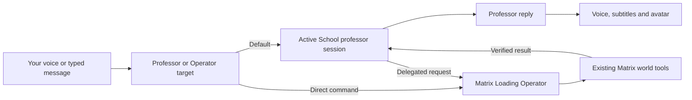

# Professor conversation and Operator delegation

Planning update, October 23, 2026. The target switch, shared transcript, chained voice/lip-sync and asynchronous Operator delegation are now implemented; see [Professor-Voice.md](Professor-Voice.md) and [Professor-Delegation.md](Professor-Delegation.md). Native live voice and remote Quest lesson delivery below remain planned.

## Product decision

The learner talks to the active professor. School supplies that professor's persona, lesson, saved conversation and assessment state. The avatar renders the professor's voice and behavior. Matrix Loading Operator is a delegated worker for world actions; it is not the default destination of the learner's speech in Professor mode.

Owner clarification: retain direct human access to Matrix Loading Operator as well. The learner and professor can both request Matrix actions through the same execution system. Add an explicit **Professor | Operator** conversation target switch, defaulting to Professor when a lesson opens. Preserve the existing Operator voice-to-Codex path; add the professor layer around it rather than replacing it. Record captured speech from both routes in a shared, attributed lesson conversation journal.

Codex is currently the provider used to generate School's teaching responses. The professor and Operator may both use Codex, but they have separate instructions, contexts and permissions. Changing an avatar must not silently switch either the teaching provider or the saved lesson. The persona does not grant capabilities; the application grants a bounded tool interface.

## What exists today

The supplied Riko system-check log reports working LM Studio text generation, local SoVITS speech, a wave, expression commands, and a two-line speech/lip-sync demonstration. It reports memory disabled and sample tools enabled. Its microphone test was skipped because browser input was selected. It does not establish hands-free noise handling, full-duplex interruption, real weather tools, or any Matrix integration. This planning pass read source but did not rerun the checks or start Riko.

At the original planning baseline, Matrix professor support covered VRM rendering, relaxed pose, gaze, blink, appearance selection, saved teacher/lesson identity and selection to reopen the lesson. The current checkpoint adds local speech, SoVITS playback, audio-driven mouth animation, Professor/Operator routing and asynchronous Operator delegation. A semantic emote matcher remains future work.

School already supplies a substantial historical persona, not just a display name. `server/teaching.mjs` reconstructs it with goals, preferences, objectives, saved messages and bounded verified Operator results. `server/codex.mjs` currently runs a constrained structured-response provider with tools disabled. `server/schemas.mjs` permits presentation proposals, explicitly not execution. `useOperator.ts` and Matrix's `professor_operator.js` provide manual, correlated image/build requests; extend this path rather than creating a second world controller.

## Conversation flow

The reply path and Operator job run independently. A task acknowledgement can be spoken once the job is accepted. The professor describes completion only after a matching receipt and world observation. Stopping speech and cancelling a build are different actions.

## Explicit voice target and shared context

Use a visible two-button target selector: **Professor** and **Operator**. The microphone label includes the selected recipient, on both desktop and the XR panel. The normal lesson starts with Professor selected. Operator mode sends speech directly through the existing Agent Portal/Codex conversation, retaining current steering, permission and failure behavior. Returning to Professor resumes the same lesson, not a new persona or empty conversation. If no professor is active, require selecting a lesson or explicitly selecting Operator; never silently send intended professor speech to Operator.

Capture the target, teacher, lesson, world and conversation identity when recording begins. A target change while transcribing must not retarget that utterance. If the captured session becomes invalid, retain the recognized text as a recoverable draft and identify its original target. A single recorded utterance is transcribed once and dispatched to one target. Teacher access and direct learner access share Matrix's authoritative world execution and applicable action permissions; neither route creates a second world controller.

Add a versioned, append-only conversation-event journal to the existing School session store, using its serialized transactions. Do not use the legacy Matrix six-turn browser conversation buffer as the lesson archive. Preserve existing School messages; expose them through a compatible journal projection and backfill stable event IDs rather than resetting the archive. Operator keeps its existing execution records; the lesson journal records linked conversational events and verified outcomes from those records.

Each event has a stable event ID, source turn ID, timestamp, lesson/teacher/world identity, speaker, recipient, input kind and delivery state. Task-related events also carry task ID, request revision and verified receipt references. Store these event types:

- Learner speech to Professor, using the recognized transcript.
- Learner speech to Operator, explicitly attributed as a direct command, not a request for the professor to execute again.
- Professor response text and its spoken/delivered status.
- Operator's user-facing response, including any spoken reply; never private chain-of-thought or internal reasoning.
- Delegation accepted, progress worth communicating, completed, failed and cancelled, tied to actual task records.

For SoVITS, the professor response text already exists: save that text and track what the audio delivered rather than running speech recognition over generated audio. For native speech output, save the provider's output transcript. Preserve the full generated response separately from the heard portion where interrupted playback can be identified; otherwise mark delivery interrupted/uncertain instead of claiming all text was heard. Never feed speaker playback back through the microphone as a new learner turn.

Both conversation routes can use the relevant shared journal. The professor receives direct Operator requests and their verified results as attributed context, so it understands changes the learner made. Operator receives the active lesson, the relevant preceding conversation and current world facts when useful. Context must not re-execute previously logged commands. Keep archived conversation complete; build bounded model context from recent turns, a maintained summary and relevant older events. Journal events from Operator must not be scored as the learner demonstrating subject knowledge.

Reconnect/retry is idempotent by event and task ID. If a command executes but the journal update fails, retry only journal reconciliation, not world execution. Capture occurs during an active, visibly indicated conversation/microphone session; this design does not imply recording room speech while the microphone is off.

## Implementation order

### 1. Route conversation to the selected professor

First add the shared journal and target-aware voice controller, keyed by School session ID, teacher ID, avatar object ID and a connection generation. Typed input and transcribed speech use the selected target: the existing School message route for Professor, or the existing Agent Portal route for direct Operator access. Preserve revision checks, saved history, steering and recoverable failed-delivery drafts. Starting Professor speech must not send the same utterance to Riko's independent chat loop or Operator's chat.

Add states listening, transcribing, thinking, speaking, interrupted and failed. Switching teacher/world invalidates pending replies and audio from the old generation. One speech session owns the microphone and output at a time. The active lesson remains the authoritative conversation record.

### 2. Give that professor the avatar's voice

Introduce a playback adapter owned by Matrix, rather than loading a second Riko scene. For the first compatibility mode, use the existing local SoVITS service behind a PC-side adapter. Return same-origin audio to the client; do not expose the voice service directly to the headset. Reuse/adapt Riko's audio-analysis approach for mouth shapes on the already-loaded Matrix VRM. It is amplitude/spectrum-driven mouth animation, not a claim of exact phoneme alignment.

Use the actual playback clock for subtitles and expression timing. Stop must flush queued audio, reset mouth shapes and prevent stale completion callbacks. Add a small allowlisted expression/emote set first, with neutral/idle fallbacks; unsupported labels or motion assets must not fail the teaching response. Inspect motion compatibility and permissions before reusing external animation files. The full embedding model and 60-animation matcher are optional later parity, not prerequisites for speech.

This compatibility mode still has transcription -> teaching model -> synthesis latency. The current teaching provider returns complete structured JSON, so first-sentence playback cannot be promised before that response arrives. Measure before optimizing; wiring audio alone will not turn it into live voice.

### 3. Expose Operator as a bounded professor capability

Add a server-owned delegation adapter for requesting an exhibit/setting, checking a job, revising an identified exhibit, and cancelling a specific job. Reuse existing School presentation identity, Operator action IDs, current world validation and receipts. Simple registered primitives should use the existing fast Matrix path; use long-running generation or Blender only when needed.

The initial Codex teaching adapter can emit validated structured delegation intent. The server converts that intent to an authorized job. Native function-calling providers can map their tool calls to the same adapter later. Do not merely enable general shell/MCP tools in the teaching CLI or treat generated text as executable commands.

A request includes School session ID, teaching turn ID, unique task ID, request revision, expected world identity, allowed action kind and bounded arguments. The acceptance response returns a task handle immediately. Progress, final result and error events retain these IDs. Retries reuse a task; stale results stay attached to their original lesson and never speak through another professor. Voice interruption does not implicitly cancel work. Cancellation is reported successful only when confirmed.

Begin with explicit requested creation such as "show me two cubes". Let the learner choose a persistent preference for whether the professor may also start small illustrative tasks proactively. Continue existing review/approval behavior for actions outside that scope. World replacement or clearing is never implied by permission to add a teaching aid.

### 4. Add natural live conversation through the same session

Keep conversation transport replaceable. A native live voice front end receives the active teacher's speaking style, current lesson summary, recent turns and verified scene facts. Detailed teaching/exhibit work delegates to the existing backend. Persist final transcripts and job results in School; do not create a second independent lesson archive.

GPT-Live's client-delegation architecture matches a conversational voice front end with an existing backend agent. Its documentation describes full-duplex speech while delegated work continues. Embedded API setup requires its supported server credentials; this plan does not assume that the current Codex teaching login is also an embedded live-voice credential. Select the voice provider/account separately before implementation of this phase. Native live speech normally supplies its own audio; SoVITS stays an alternate compatibility voice path, not an extra synthesis step in front of live speech.

### 5. Complete headset delivery and catalog growth

The present full School page is PC-loopback-only. Implement an authenticated same-origin headset-facing Professor surface/proxy using the existing Matrix deployment and certificate pattern. Keep service credentials on the PC. Validate headset microphone selection, speaker output, echo behavior, world-space voice position, room floor/scale and performance on the actual Quest.

Then add curated avatar metadata and matching: appearance tags, optional explicit historical matches, license eligibility and a learner override. Select only registered allowed catalog IDs, explain approximate matches and preserve the same lesson when the body changes. A small versioned catalog is sufficient; no vector database is required initially.

## First end-to-end acceptance example

1. Open a saved Ada Lovelace lesson, choose Riko, then Talk to Professor.
2. Say "Explain a loop." Only the active lesson receives the utterance. The reply is saved, spoken and lip-synced through that avatar.
3. Say "Show me three counters." A bounded Operator task is accepted, and the professor can continue talking while it runs.
4. Completion identifies the actual created objects; failure produces an honest failure statement. Request a revision and preserve those object identities where supported.
5. Interrupt speech, switch lesson during a pending task, retry a request and reconnect. No duplicate objects, crossed transcripts, late audio or false completion claims.
6. Save/reopen the world and lesson with the same binding. Repeat microphone/output and physical alignment checks on Quest.
7. Switch to Operator, say "Move those counters to the left," and verify the transcript is attributed to a direct Operator command and the movement occurs once. Return to Professor and ask "Why did I move them?" It can use the preceding request and verified outcome without issuing the command again.
8. Switch target during transcription, interrupt a spoken reply, and reload after a completed task. Verify correct recipient, honest audio delivery status, complete journal recovery and no duplicate task or event. Operator's command/response must not count as the learner solving a quiz.

Record end-of-speech, transcription completion, model first output, first audio ready, actual playback start, job accepted and job completed separately. Compare end-of-speech-to-first-audible-response under the same provider, scene and hardware; do not compare a short text benchmark with the learner's full spoken turn.

## Source references

- Current School: `server/codex.mjs`, `server/schemas.mjs`, `server/teaching.mjs`, `src/school/useOperator.ts`.
- Current Matrix: `WebRuntime/src/main.js`, `professor_operator.js`, `professor_avatar.js`, `vrm_avatar.js`, and `ControlService/professor_actions.py`.
- Riko reference: `server/streaming_agent/inputs/browser_voice_input.py`, `server/playback/playback.py`, `server/tts/sovits.py`, `client/core/audioManager.js`, `client/core/playbackController.js`.
- Official live voice/delegation: https://developers.openai.com/api/docs/guides/live
- Official Realtime voice/tools: https://developers.openai.com/api/docs/guides/realtime
