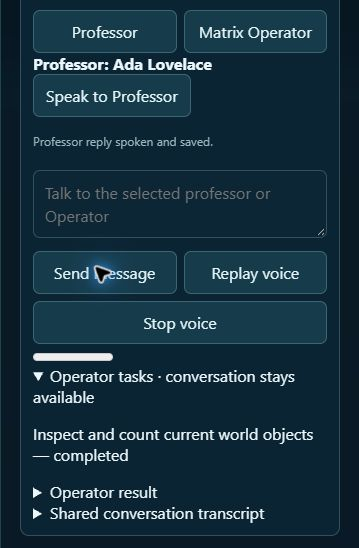

# Professor to Operator: asynchronous task checkpoint

October 23, 2026. Related: [Matrix #212](https://github.com/School-of-the-Ancients/matrix-loading-operator/issues/212), [School #5](https://github.com/School-of-the-Ancients/sota-professor/issues/5), and the broader #187 / School #3 plans.

## Use

Start the existing local candidate, then open **http://127.0.0.1:8765/web/** on the PC. Open Professor and choose a lesson. Connect Operator with its existing permission settings. Ask the professor to have Operator inspect, create or revise something in Matrix. The professor can answer further questions while the job runs.

The **Operator tasks** panel shows requested, queued, running, completed, failed, cancelled or unconfirmed state. The task's result is retained with the lesson and is available to subsequent teaching turns. A requested task that could not connect can be sent/checked explicitly. Retrying the same saved task ID does not start another job. Stop voice and Cancel task are different controls; cancellation does not undo already completed world edits.

## Architecture

School's structured teaching output now advertises an app-mediated `matrix_operator` tool with bounded title, instruction and lesson objective. School validates it and saves a task with the source reply ID. It does not give the teaching process direct shell, MCP, account or filesystem tools.

Matrix submits the saved intent through the existing Agent Portal/Operator. A durable queue returns a task handle before the worker finishes. Teacher generation, audio playback and Operator execution use separate paths. The queue waits if Operator already has a turn, preserves the current permissions and checks the originating world/runtime before execution.

Saved Professor tasks use an internal text-task route. Words such as “concept”
or “design” in an invention brief do not select the current concept image or
require one to exist. The separate image-to-Blender action still validates its
exact selected image and version. Browser callers cannot enable the internal
task route through JSON fields. A rejected task with no Operator turn ID did
not start a Blender build; retain its record rather than silently replaying it.

Task IDs and arguments are immutable. A persisted submission state is written before starting Operator, so a crash cannot silently replay an uncertain world action. Restarted queued/running jobs become unconfirmed for explicit review. Completed means that the correlated Operator turn completed; it does not independently prove geometry, scientific validity or physical AR fit. Existing runtime receipts remain authoritative.

Adding a registered model or built-in object does not require the entire scene to remain motionless. An observed revision stays valid for an additive load while the same runtime, world and tracking origin remain active; existing object movement and new unrelated objects do not cancel it. Scene replacement, reconnect, world switching and origin changes still require a fresh observation. Edits to existing objects and measured physical-surface placement keep their own target checks.

The School result endpoint fetches the actual Matrix task record and checks its lesson ID, task ID, instruction and objective before saving status. It does not accept a client-authored success result. The next teaching context includes verified task status and the attributed Operator report. Delegation is recorded as Professor → Operator, not as an extra learner command.

## Validation

- Full Matrix checks at this checkpoint: 1,006 Python tests and 837 WebRuntime tests passed. Focused queue, restart, stale-world, cancellation, identity and non-blocking conversation tests also pass.
- School: 55 server tests and 26 UI tests passed, plus type checking and both production builds.
- A real local Codex-backed professor requested read-only world inspection. Matrix Operator started a separate real turn, used the current world inventory and reported exactly one authored object.
- While the Operator turn ran, the learner submitted another teaching question. The professor answered and played speech without waiting on the Operator task queue.
- A subsequent professor answer correctly reported the returned count and no second task was created. Existing scene object identity was preserved. This test used an isolated lesson/world archive.
- The UI-only screenshot below omits the local avatar asset and records task completion alongside available conversation controls.

This is a source checkpoint, not a release. Quest delivery/physical acceptance and native full-duplex voice remain pending. The local full School surface remains PC-loopback-only.
